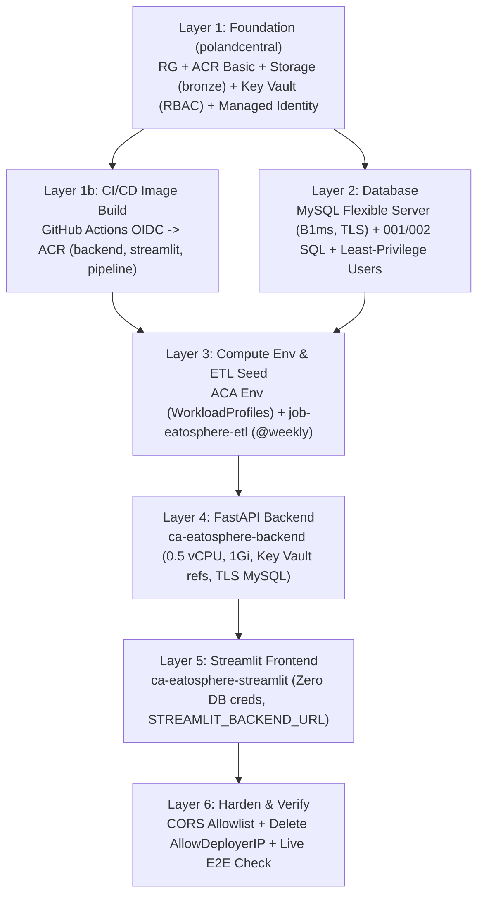
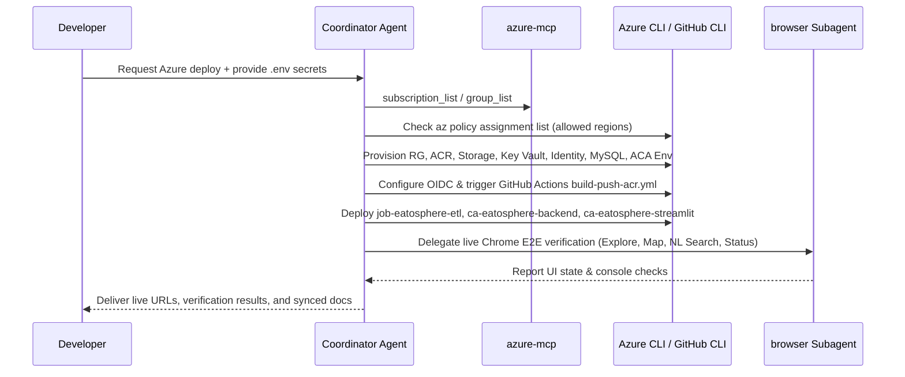

# Production Deployment Guide on Microsoft Azure

> **Last updated:** 2026-11-26  
> **Target Environment:** Microsoft Azure (`Azure for Students`, \$100 credit budget) · Region: `polandcentral`  
> **Live Endpoints:**  
> - **Streamlit Web App:** https://ca-eatosphere-streamlit.politeriver-19c81647.polandcentral.azurecontainerapps.io  
> - **FastAPI Backend & OpenAPI:** https://ca-eatosphere-backend.politeriver-19c81647.polandcentral.azurecontainerapps.io/docs  

This guide covers deploying **Global Restaurant Explorer** from scratch on Azure using **two workflows**:
- **Track A:** Manual CLI & GitHub Actions workflow (no AI agents or MCPs required).
- **Track B:** Delegated Agentic / MCP-assisted workflow (`azure-mcp`, `gh`, and `browser` subagent).

---

## 1. Production Architecture & Bottom-Up Deployment Flow

Resources are provisioned **bottom-up** in strict dependency order so each layer receives validated endpoints and Managed Identity permissions from the layer below it:



### Deployed Resource Inventory (`rg-eatosphere-prod`)

| Layer | Resource Name | Tier / Sizing | Purpose |
| --- | --- | --- | --- |
| Resource Group | `rg-eatosphere-prod` | `polandcentral` | Subscription-policy-compliant region |
| Container Registry | `acreatosphere2611` | `Basic` (admin disabled) | Stores `backend`, `streamlit`, `pipeline` images |
| Blob Storage | `steatosphere2611` | `Standard_LRS` (`bronze` container) | Append-only raw Kaggle Zomato batches |
| Key Vault | `kv-eatosphere-2611` | `Standard` (RBAC enabled) | Holds 7 secrets accessed via Managed Identity |
| Managed Identity | `id-eatosphere-prod` | User-Assigned | `AcrPull`, `AcrPush` (OIDC), `Key Vault Secrets User` |
| MySQL Server | `mysql-eatosphere-2611` | Burstable `Standard_B1ms`, 20 GB | MySQL `8.0.21`, TLS required |
| ACA Environment | `cae-eatosphere-prod` | `WorkloadProfiles` Consumption | Hosts Scheduled Job + Backend + Streamlit |
| ETL Job | `job-eatosphere-etl` | `0.5` vCPU, `1.0Gi` RAM, `@weekly` | Runs `pipeline:latest` (`0 3 * * 0` UTC) |
| Backend App | `ca-eatosphere-backend` | `0.5` vCPU, `1.0Gi` RAM, `0–2` replicas | FastAPI + pre-baked `all-MiniLM-L6-v2` ONNX |
| Streamlit App | `ca-eatosphere-streamlit` | `0.5` vCPU, `1.0Gi` RAM, `0–1` replicas | Editorial UI; zero DB credentials |

---

## 2. Track A: Manual Deployment Workflow (Without MCPs or Agents)

### 2.1 Prerequisites
- [Azure CLI (`az`)](https://learn.microsoft.com/en-us/cli/azure/install-azure-cli) logged in (`az login`), plus `containerapp` extension:
  ```powershell
  az extension add --name containerapp --upgrade -y
  ```
- [GitHub CLI (`gh`)](https://cli.github.com/) logged in (`gh auth login`)
- Python 3.12+ `.venv` with `pymysql` installed (for one-time TLS schema initialization)
- Valid `KAGGLE_USERNAME`, `KAGGLE_KEY`, and `HF_API_KEY` values ready in `.env`

### 2.2 Step 1 — Register Providers & Provision Layer 1 Foundation

```powershell
$SUB = "<your-subscription-id>"
$RG = "rg-eatosphere-prod"
$LOC = "polandcentral"
$ACR = "acreatosphere2611"
$ST = "steatosphere2611"
$KV = "kv-eatosphere-2611"
$ID = "id-eatosphere-prod"

az account set --subscription $SUB
az group create --name $RG --location $LOC

# Register required Azure resource providers (wait until all show 'Registered')
foreach ($ns in @("Microsoft.App","Microsoft.OperationalInsights","Microsoft.ContainerRegistry","Microsoft.DBforMySQL","Microsoft.KeyVault","Microsoft.Storage","Microsoft.ManagedIdentity")) {
  az provider register --namespace $ns
}

# 1. Container Registry
az acr create --name $ACR --resource-group $RG --sku Basic --admin-enabled false --location $LOC

# 2. Bronze Blob Storage
az storage account create --name $ST --resource-group $RG --location $LOC --sku Standard_LRS --kind StorageV2 --min-tls-version TLS1_2 --allow-blob-public-access false
$ST_KEY = az storage account keys list --resource-group $RG --account-name $ST --query "[0].value" -o tsv
az storage container create --name bronze --account-name $ST --account-key $ST_KEY

# 3. Key Vault (RBAC) + Admin role for deployer
az keyvault create --name $KV --resource-group $RG --location $LOC --enable-rbac-authorization true
$USER_ID = az ad signed-in-user show --query id -o tsv
$KV_ID = az keyvault show --name $KV --resource-group $RG --query id -o tsv
az role assignment create --assignee $USER_ID --role "Key Vault Secrets Officer" --scope $KV_ID

# 4. User-Assigned Managed Identity + RBAC
$ID_PRINCIPAL = az identity create --name $ID --resource-group $RG --location $LOC --query principalId -o tsv
$ACR_ID = az acr show --name $ACR --resource-group $RG --query id -o tsv
az role assignment create --assignee-object-id $ID_PRINCIPAL --assignee-principal-type ServicePrincipal --role AcrPull --scope $ACR_ID
az role assignment create --assignee-object-id $ID_PRINCIPAL --assignee-principal-type ServicePrincipal --role AcrPush --scope $ACR_ID
az role assignment create --assignee-object-id $ID_PRINCIPAL --assignee-principal-type ServicePrincipal --role "Key Vault Secrets User" --scope $KV_ID
```

Store the 7 required secrets in `kv-eatosphere-2611` (never echo secrets to terminal logs):
`mysql-admin-password`, `mysql-pipeline-password`, `mysql-app-password`, `azure-storage-connection-string`, `kaggle-username`, `kaggle-key`, and `hf-api-key`.

### 2.3 Step 2 — Build & Push Images via GitHub Actions OIDC

Because `Azure for Students` blocks remote `az acr build` (`TasksOperationsNotAllowed`) and local `docker push` can time out on slow home uploads, [`.github/workflows/build-push-acr.yml`](../.github/workflows/build-push-acr.yml) builds and pushes all 3 `linux/amd64` images directly from GitHub Actions using OIDC:

```powershell
$OWNER = "<github-owner>"
$OWNER_ID = "<github-owner-numeric-id>"
$REPO = "<repo-name>"
$REPO_ID = "<github-repo-numeric-id>"

# Create federated identity credentials matching GitHub's OIDC subject format
az identity federated-credential create --name github-main-id --identity-name $ID --resource-group $RG --issuer https://token.actions.githubusercontent.com --subject "repo:${OWNER}@${OWNER_ID}/${REPO}@${REPO_ID}:ref:refs/heads/main" --audiences api://AzureADTokenExchange

$CLIENT_ID = az identity show --name $ID --resource-group $RG --query clientId -o tsv
$TENANT_ID = az account show --query tenantId -o tsv
gh secret set AZURE_CLIENT_ID --body $CLIENT_ID --repo "$OWNER/$REPO"
gh secret set AZURE_TENANT_ID --body $TENANT_ID --repo "$OWNER/$REPO"
gh secret set AZURE_SUBSCRIPTION_ID --body $SUB --repo "$OWNER/$REPO"

# Trigger or push to run .github/workflows/build-push-acr.yml
gh workflow run build-push-acr.yml --repo "$OWNER/$REPO"
```

### 2.4 Step 3 — Provision & Initialize Azure MySQL Flexible Server

```powershell
$ADMIN_PW = az keyvault secret show --vault-name $KV --name mysql-admin-password --query value -o tsv
az mysql flexible-server create --resource-group $RG --name mysql-eatosphere-2611 --location $LOC --admin-user eatoadmin --admin-password $ADMIN_PW --sku-name Standard_B1ms --tier Burstable --storage-size 20 --version 8.0.21 --public-access 0.0.0.0

# Temporarily allow your deployer IP for schema initialization
$MY_IP = (Invoke-RestMethod https://api.ipify.org).Trim()
az mysql flexible-server firewall-rule create --resource-group $RG --name mysql-eatosphere-2611 --rule-name AllowDeployerIP --start-ip-address $MY_IP --end-ip-address $MY_IP
```

Connect over verified TLS (`ssl.create_default_context()`) using Python + `pymysql`:
1. As `eatoadmin`, execute [`sql/001_create_tables.sql`](../sql/001_create_tables.sql), then create `explorer_pipeline`@`%` (write + DDL/views on `global_restaurant_explorer.*`) and `explorer_app`@`%` (`SELECT` only).
2. As `explorer_pipeline`, execute [`sql/002_create_gold_views.sql`](../sql/002_create_gold_views.sql).

### 2.5 Step 4 — Create ACA Environment (`WorkloadProfiles`) & Seed ETL Job

```powershell
$ID_RES = az identity show --name $ID --resource-group $RG --query id -o tsv
$KV_URL = "https://$KV.vault.azure.net"

# IMPORTANT: Use --environment-mode WorkloadProfiles (Express mode blocks Jobs and Key Vault refs)
az containerapp env create --name cae-eatosphere-prod --resource-group $RG --location $LOC --environment-mode WorkloadProfiles

az containerapp job create `
  --name job-eatosphere-etl `
  --resource-group $RG `
  --environment cae-eatosphere-prod `
  --trigger-type Schedule `
  --cron-expression "0 3 * * 0" `
  --replica-timeout 1800 --replica-retry-limit 1 --parallelism 1 --replica-completion-count 1 `
  --image "$ACR.azurecr.io/pipeline:latest" `
  --registry-server "$ACR.azurecr.io" `
  --registry-identity $ID_RES `
  --mi-user-assigned $ID_RES `
  --cpu 0.5 --memory 1.0Gi `
  --secrets "mysql-pipeline-password=keyvaultref:$KV_URL/secrets/mysql-pipeline-password,identityref:$ID_RES" "azure-storage-connection-string=keyvaultref:$KV_URL/secrets/azure-storage-connection-string,identityref:$ID_RES" "kaggle-username=keyvaultref:$KV_URL/secrets/kaggle-username,identityref:$ID_RES" "kaggle-key=keyvaultref:$KV_URL/secrets/kaggle-key,identityref:$ID_RES" `
  --env-vars "APP_ENV=production" "STORAGE_BACKEND=azure" "MYSQL_HOST=mysql-eatosphere-2611.mysql.database.azure.com" "MYSQL_PORT=3306" "MYSQL_DATABASE=global_restaurant_explorer" "MYSQL_TLS_ENABLED=TRUE" "MYSQL_PIPELINE_USER=explorer_pipeline" "MYSQL_PIPELINE_PASSWORD=secretref:mysql-pipeline-password" "AZURE_STORAGE_CONNECTION_STRING=secretref:azure-storage-connection-string" "KAGGLE_USERNAME=secretref:kaggle-username" "KAGGLE_KEY=secretref:kaggle-key"

# Trigger initial load
az containerapp job start --name job-eatosphere-etl --resource-group $RG
```

### 2.6 Step 5 — Deploy Backend & Streamlit, Wire CORS, Lock Down MySQL

```powershell
# 1. Deploy FastAPI Backend
$BACKEND_FQDN = az containerapp create `
  --name ca-eatosphere-backend --resource-group $RG --environment cae-eatosphere-prod `
  --image "$ACR.azurecr.io/backend:latest" --registry-server "$ACR.azurecr.io" --registry-identity $ID_RES `
  --ingress external --target-port 8000 --cpu 0.5 --memory 1.0Gi --min-replicas 0 --max-replicas 2 `
  --secrets "mysql-app-password=keyvaultref:$KV_URL/secrets/mysql-app-password,identityref:$ID_RES" "hf-api-key=keyvaultref:$KV_URL/secrets/hf-api-key,identityref:$ID_RES" `
  --env-vars "APP_ENV=production" "MYSQL_HOST=mysql-eatosphere-2611.mysql.database.azure.com" "MYSQL_PORT=3306" "MYSQL_DATABASE=global_restaurant_explorer" "MYSQL_TLS_ENABLED=TRUE" "MYSQL_APP_USER=explorer_app" "BACKEND_ALLOW_CSV_FALLBACK_IN_LOCAL=false" "BACKEND_CORS_ORIGINS=https://placeholder.invalid" "MYSQL_APP_PASSWORD=secretref:mysql-app-password" "HF_API_KEY=secretref:hf-api-key" `
  --query "properties.configuration.ingress.fqdn" -o tsv

# 2. Deploy Streamlit Frontend (zero DB credentials)
$ST_FQDN = az containerapp create `
  --name ca-eatosphere-streamlit --resource-group $RG --environment cae-eatosphere-prod `
  --image "$ACR.azurecr.io/streamlit:latest" --registry-server "$ACR.azurecr.io" --registry-identity $ID_RES `
  --ingress external --target-port 8501 --cpu 0.5 --memory 1.0Gi --min-replicas 0 --max-replicas 1 `
  --env-vars "STREAMLIT_BACKEND_URL=https://$BACKEND_FQDN" "STREAMLIT_API_TIMEOUT_SECONDS=30" `
  --query "properties.configuration.ingress.fqdn" -o tsv

# 3. Wire exact CORS origin and remove temporary deployer MySQL firewall rule
az containerapp update --name ca-eatosphere-backend --resource-group $RG --set-env-vars "BACKEND_CORS_ORIGINS=https://$ST_FQDN"
az mysql flexible-server firewall-rule delete --resource-group $RG --name mysql-eatosphere-2611 --rule-name AllowDeployerIP --yes
```

---

## 3. Track B: Agentic / MCP-Assisted Deployment Workflow

When deploying with an AI coding agent (such as Antigravity with `azure-mcp` and `browser` subagents), follow this delegation pattern to minimize manual work and catch policy/runtime issues early:



### Delegation & Safety Rules for Agents
1. **Use `azure-mcp` for discovery first:** Call `subscription_list` and `group_list` before issuing CLI commands; always verify `az policy assignment list` on student subscriptions before selecting a region.
2. **Never echo secrets:** Read `.env` values in Python/PowerShell memory only, pass them directly to `az keyvault secret set ... -o none`, and never print secret values to stdout.
3. **Offload container builds to GitHub Actions:** Prefer pushing [`.github/workflows/build-push-acr.yml`](../.github/workflows/build-push-acr.yml) over local `docker push` on constrained connections.
4. **Delegate live UI verification to `browser` subagent:** Ensure Google Chrome is running with remote debugging enabled (`chrome://inspect/#remote-debugging`) before delegating live Streamlit E2E checks (Explore, Map Explorer, NL Search + follow-ups + off-topic guardrail, Pipeline Status).

---

## 4. Common Errors Encountered & Exact Fixes

| Error / Code | Where It Occurs | Root Cause | Exact Fix |
| --- | --- | --- | --- |
| `RequestDisallowedByAzure` | `az acr create` / resource creation | `Azure for Students` policy restricts allowed regions | Run `az policy assignment list` to find allowed regions (e.g., `polandcentral`) and deploy there |
| `TasksOperationsNotAllowed` | `az acr build` | ACR Tasks are disabled on `Azure for Students` | Build and push via GitHub Actions OIDC ([`.github/workflows/build-push-acr.yml`](../.github/workflows/build-push-acr.yml)) |
| `AADSTS700213: No matching federated identity record` | `azure/login@v2` in GitHub Actions | GitHub OIDC `sub` includes `@<owner_id>` and `@<repo_id>` | Set federated credential `--subject` to the exact `sub` reported in the error (`repo:<owner>@<id>/<repo>@<id>:ref:refs/heads/<branch>`) |
| `ExpressEnvironmentResourceNotSupported` / `ExpressKeyVaultSecretsNotSupported` | `az containerapp job create` / `az containerapp create` | Preview `containerapp` CLI defaults `env create` to `Express` mode | Recreate environment with `--environment-mode WorkloadProfiles` |
| `Secret "<app>--msi" not found` | `az containerapp create` with Key Vault refs | Passing both `--registry-identity` and `--user-assigned` for the same identity causes an identity conflict | Pass `--registry-identity $ID_RES` only (or `--mi-user-assigned` on jobs) |
| `ModuleNotFoundError: No module named 'six'` | `job-eatosphere-etl` execution | `kaggle` 1.x has an undeclared runtime dependency on `six` | Pinned `six>=1.16.0,<2.0.0` in [`pipeline/requirements.txt`](../pipeline/requirements.txt) |
| `SSL connection error` / TLS handshake rejected | PyMySQL -> Azure MySQL Flexible Server | Passing `{}` or `{"ssl_mode": "REQUIRED"}` skips cert verification in PyMySQL | Use `ssl.create_default_context()` when `mysql_tls_enabled=True` |
| `Access denied; you need SUPER or SET_USER_ID` | `sql/002_create_gold_views.sql` | Standard `CREATE OR REPLACE VIEW` defaults to `DEFINER` privilege checks | Use `CREATE OR REPLACE SQL SECURITY INVOKER VIEW` on all Gold views |
| `ValueError: ... must not be empty or a placeholder in production` | Backend startup with `APP_ENV=production` | `validate_production_secrets` blocks `replace_with_*` or empty secrets | Populate real values in Key Vault (`mysql-app-password`, `hf-api-key`) |
| `Could not find DevToolsActivePort for chrome` | `browser` subagent E2E check | Chrome is closed or remote debugging is disabled | Open Chrome and enable `chrome://inspect/#remote-debugging`, then re-run |

---

## 5. Estimated Monthly Cost & Teardown

| Azure Service | Tier / Sizing | Est. Monthly Cost |
| --- | --- | --- |
| Azure Database for MySQL Flexible Server | Burstable `Standard_B1ms`, 20 GB | `~$0–$13` (Student free tier / Burstable) |
| Azure Container Registry | `Basic` | `~$5` |
| Azure Container Apps (`backend`, `streamlit`, `job-eatosphere-etl`) | Consumption (`minReplicas=0`, `@weekly` job) | `~$0–$3` (within 180k vCPU-s free grant) |
| Azure Storage Account + Key Vault | `Standard_LRS` (`bronze`) + Standard RBAC | `< $0.20` |
| **Total** | | **~\$5–\$21/month** (well within \$100 credit) |

To delete all Azure resources and stop all billing:

```powershell
az group delete --name rg-eatosphere-prod --yes --no-wait
```
